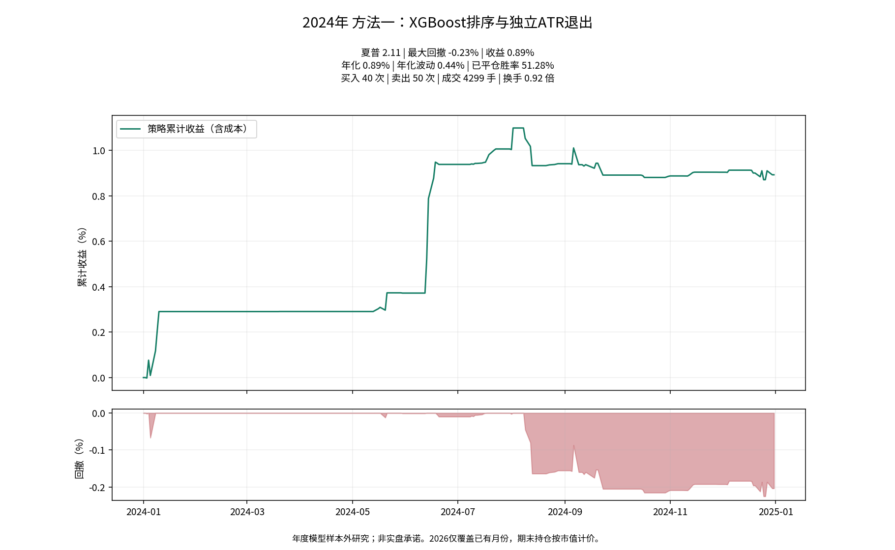

# 2024年 方法一：XGBoost排序与独立ATR退出

规则：`atr240_initial3_trail6_time5_q0.9`（验证集正夏普且交易数量达标）。

| 指标                             | 结果      |
|:---------------------------------|:----------|
| 总收益率                         | 0.89%     |
| 年化收益率                       | 0.89%     |
| 年化波动率                       | 0.44%     |
| 夏普比率                         | 2.1137    |
| 下行风险调整收益比               | 5.6788    |
| 最大回撤                         | -0.23%    |
| 年化收益与最大回撤比             | 3.9678    |
| 买入成交次数                     | 40.0000   |
| 卖出成交次数（含部分卖出）       | 50.0000   |
| 完全平仓批次数                   | 39.0000   |
| 双边成交手数                     | 4299.0000 |
| 完全平仓批次胜率                 | 51.28%    |
| 平均持仓自然日                   | 3.1477    |
| 双边换手倍数                     | 0.9249    |
| 手续费合计（元，不含价格内滑点） | 989.1922  |
| 平均多头仓位比例                 | 0.37%     |
| 交易日数                         | 242.0000  |
| 期末未平仓批次                   | 1.0000    |

## 限制

- 历史数据已被此前研究查看；本轮是预先固定流程的历史稳健性检查，不是全新未见样本。
- 原始行情无完整历史ST状态、退市总表、复权因子和公司行动。使用2026年名称快照排除ST/退，仍有前视筛选及幸存者偏差；原始价格的分红拆股也未完整记账。
- 交易只在信号之后的下一分钟收盘模拟成交。使用双边万八佣金、免5、日期对应印花税、双边十万分之一过户费和双边万五滑点。
- 每次成交额最多占下一分钟成交额5%，零量/缺失不成交；主板前收盘±9.5%是保守阻成交代理，不等于完整涨跌停、集合竞价及排队模型。停牌持仓用最后可见价格估值，无法反映退市损失。
- 止损在24分钟采样点和日终检查，不是逐分钟监控；T+1或无法卖出时保存待平仓状态，不保证以止损价成交。入场后的首个监控区间保守只用当前收盘更新最高价，避免引入买入前的分钟内高点。
- 各年从相同现金独立启动，年末持仓按市值保留，不虚构强制成交。跨年拼接只是独立年度收益的统计连接，不是连续持仓实盘仿真。
- 方法二沿用方法一的XGBoost核心，仅增加CTA叠加，不能假定两者为独立收益来源。
- 最终全量模型包含2026训练数据，必须用2026年4月之后未参与研究的新数据或模拟盘验收；不能引用年度模型成绩充当它的独立测试成绩。
