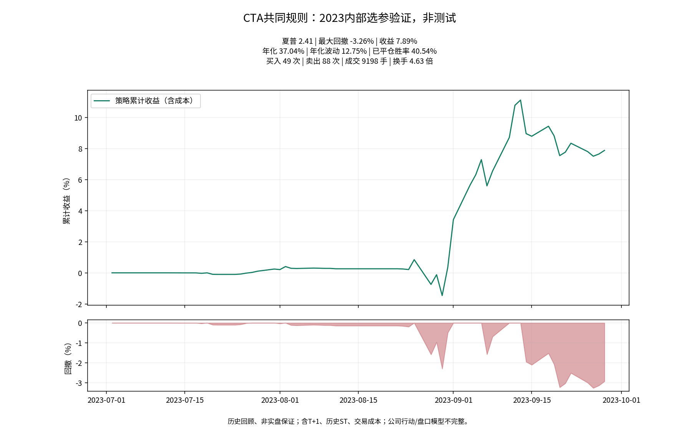
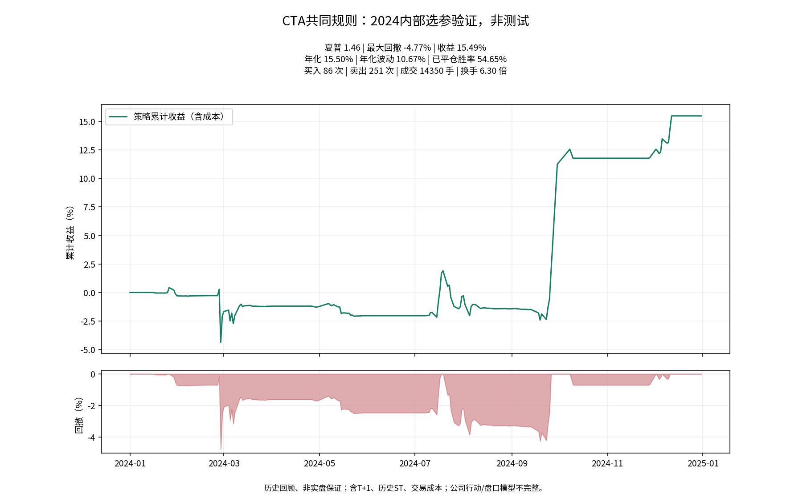
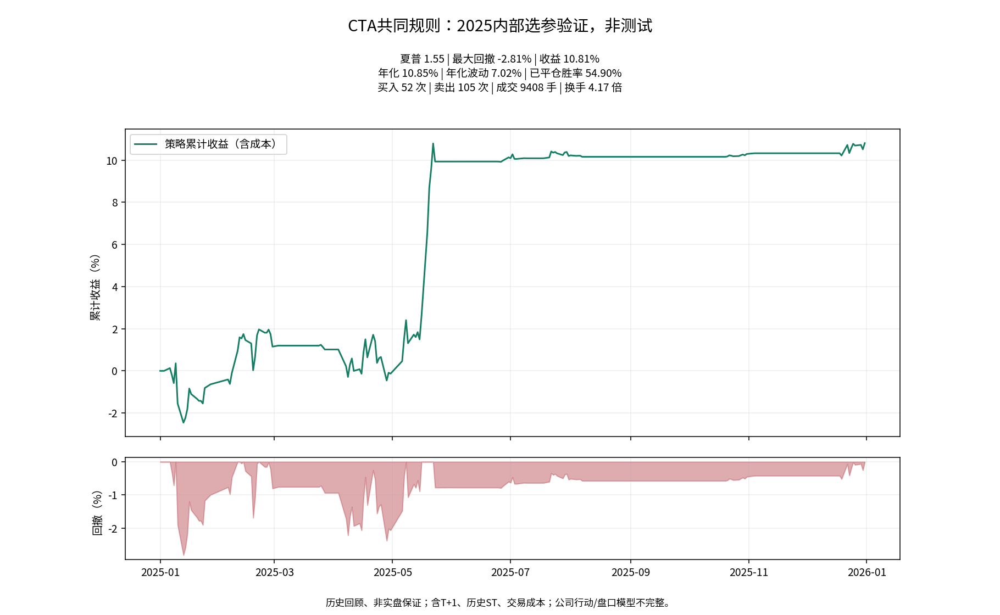

# CTA逐验证集迭代报告

尚未使各个验证集夏普均大于2，目标未完成，后续继续迭代。

本阶段共同规则2000套，真实账户6000个。禁止按年份选择不同的事后赢家，最低夏普为1.4579。

根目录兼容test_文件名及收益图仅复制最弱的2024验证折，不是2026测试，也不代表全部区间；完整判定必须看下表全部三折。

|   验证年份 |   净收益小数 |   净日夏普 |   最大回撤小数 |   完整平仓批次 |   买入次数 |
|-----------:|-------------:|-----------:|---------------:|---------------:|-----------:|
|       2023 |    0.0788813 |    2.40863 |     -0.032551  |             37 |         49 |
|       2024 |    0.154905  |    1.4579  |     -0.0477183 |             86 |         86 |
|       2025 |    0.108103  |    1.5518  |     -0.0280834 |             51 |         52 |

2023验证固定为第三季度，2024/2025为全年，没有移动原区间；夏普包含现金日、成本、T+1与实际成交限制。

## 输入与局限

复用原755只有历史状态的股票中722只曾入周池股票，创业板/科创板各3只；没有把未知ST当作非ST，不声称覆盖完整市场。
所有模型只在对应验证期之前训练；这几个验证区间正在被反复用于研究选择，所以即使全部超过2，也不能宣称未来会有相同收益。2026没有重新预测或回测。原退出、T+1、费用及每批总资产10%保留。

## 2023验证曲线

## 2024验证曲线

## 2025验证曲线

