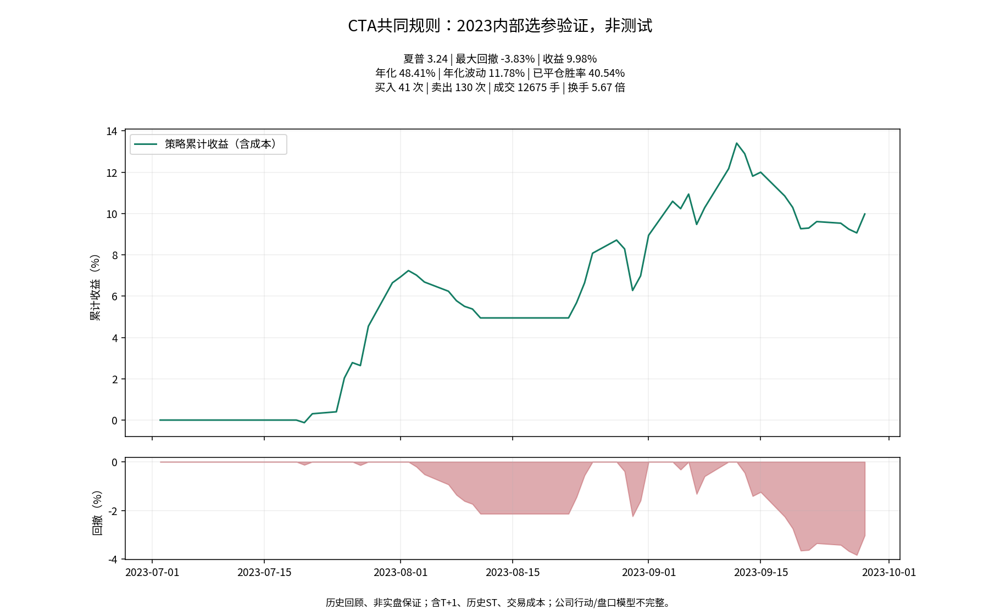
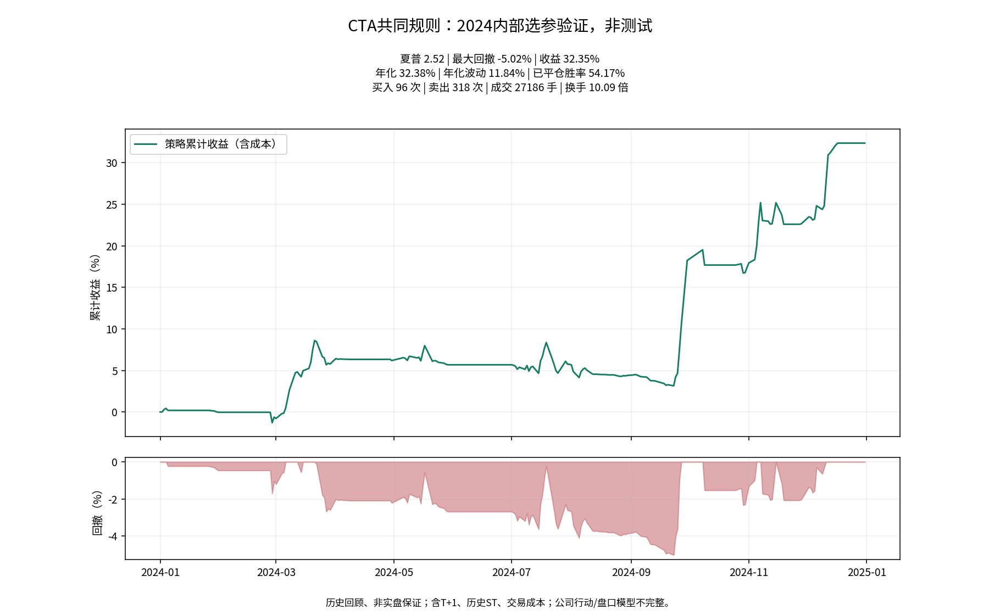
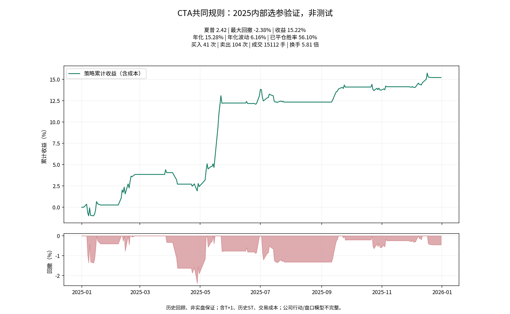

# CTA逐验证集迭代报告

全部验证集达到数值门槛，仍非独立测试证明。

策略中文名：**XGBoost开盘突破与ATR独立退出**。
完整的[策略、模型来源与复现说明](../../../8method_validation_iteration/results.md)解释每项条件及文件的读法。

## 最终复核

[独立审计](independent_audit_20260910_135916.json)通过：24个过去模型的验证预测从724列特征面板重新计算，逐值一致；
4320个候选账户的门槛及排序核对，所选3账户的现金、费用、日终权益、T+1、限价、容量与预算核对通过。
[最后验收](engineering_validation/completion_checks_20260910_140250.json)还验证标准收益CSV与分钟账本一致、原640规则/1920账户的性能优化前后完全一致。
相关测试50项通过；检查通过不等于独立泛化或实盘准备完成。

[中文完整批次复盘表](engineering_validation/closed_batch_review.csv)共174批。
2023末仍有4批未平仓，不计入完整交易胜率；2024/2025期末无持仓。卖出片段不是完整交易次数。
原始成交原因中的“模型净收益门槛”是引擎通用旧文字，本轮实际使用的是**盈利概率目标分数>0.375**，不是预测收益率37.5%。

共同规则：周池为上周高波动前300；每天09:31完成分钟后，要求价格高于20日前收盘、上一完成日EMA20及过去10日最高价，
模型分数>0.375后降序取前5，09:32才尝试买入。每笔总资产10%，单股20%/总仓80%，佣金万八免五。
批次退出为2ATR初始保护、3ATR只上移跟踪线、10交易日折算分钟到期及ST风险退出，受T+1与实际成交限制；不因掉出前5平仓。
完整费率、限价、滑点、部分成交和未校准概率的局限见上述策略说明及各验证子报告。

## 全部验证区间

本阶段共同规则1440套，真实账户4320个。禁止按年份选择不同的事后赢家，最低夏普为2.4170。

根目录兼容test_文件名及收益图仅复制最弱的2025验证折，不是2026测试，也不代表全部区间；完整判定必须看下表全部三折。

|   验证年份 |   净收益小数 |   净日夏普 |   最大回撤小数 |   完整平仓批次 |   买入次数 |
|-----------:|-------------:|-----------:|---------------:|---------------:|-----------:|
|       2023 |    0.0997881 |    3.23859 |     -0.0383274 |             37 |         41 |
|       2024 |    0.3235    |    2.52418 |     -0.050249  |             96 |         96 |
|       2025 |    0.152205  |    2.41703 |     -0.0238496 |             41 |         41 |

2023验证固定为第三季度，2024/2025为全年，没有移动原区间；夏普包含现金日、成本、T+1与实际成交限制。

## 输入与局限

复用原755只有历史状态的股票中722只曾入周池股票，创业板/科创板各3只；没有把未知ST当作非ST，不声称覆盖完整市场。
所有模型只在对应验证期之前训练；这几个验证区间正在被反复用于研究选择，所以即使全部超过2，也不能宣称未来会有相同收益。2026没有重新预测或回测。原退出、T+1、费用及每批总资产10%保留。

三折实际创业板/科创板买入次数均为0，不能据此宣称这些板块已经通过收益验证。
两个完整阶段共3440个候选槽位、3280套不重复规则，存在多重尝试带来的选择偏差；没有计算调整后显著性。
第三阶段日内时点文件只是未执行预案，没有用于选择本报告结果。

## 2023验证曲线

## 2024验证曲线

## 2025验证曲线

