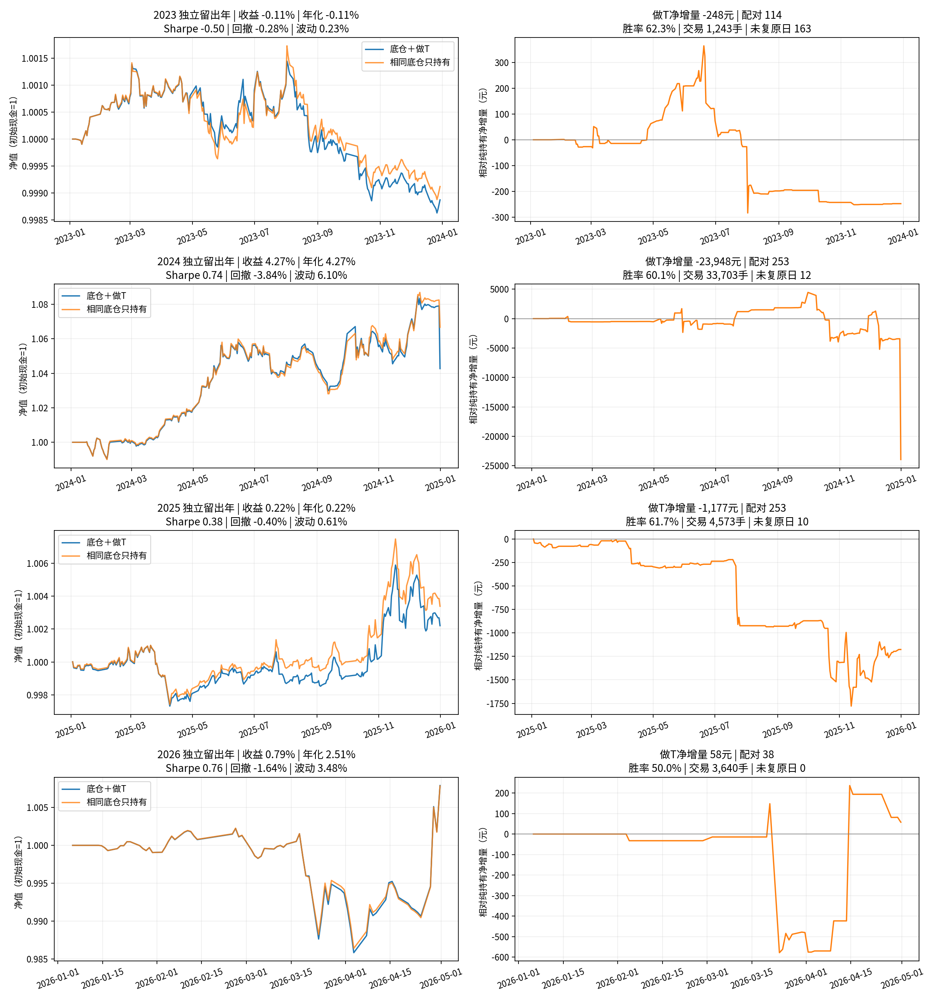

# 固定底仓做T：年度交叉验证结果

**本次没有找到同时满足每日恢复股数、又能稳定增厚收益的规则。** 四个年度折的全部做T候选都在相应训练内部出现过库存恢复失败，因此严格策略按事先规则退回只持有，做T增量为0。

为观察主动做T本身的效果，另行按每折内部净增量最高者冻结一条规则，保留真实恢复失败。以下为该诊断的留出年结果，不能把它提升为满足每日库存约束的策略。

| 留出年 | 实际底仓含费成本 | 只持有收益 | 主动做T后收益 | 做T净增量 | 股数偏差日 | 日终仍有未完成T的天数 |
|---|---:|---:|---:|---:|---:|---:|
| 2023 | 10,267.44元 | -0.09% | -0.11% | -247.87元 | 13 | 163 |
| 2024 | 116,898.98元 | 6.66% | 4.27% | -23,947.81元 | 22 | 12 |
| 2025 | 15,274.99元 | 0.34% | 0.22% | -1,176.59元 | 18 | 10 |
| 2026（截至4月30日） | 138,561.33元 | 0.78% | 0.79% | +57.69元 | 0 | 0 |

各年初始现金均为100万元，但单分钟5%成交额容量限制使实际底仓投入分别仅为1.03%、11.69%、1.53%、13.86%。目标仓位不会自动补足，因此不能把收益简单线性放大到50%或满仓。上述收益已经扣除配置中的佣金、印花税、过户费和滑点；做T净增量等于相同底仓买单下的期末权益差。

2023年有一组500股回补在SH.601258后续行情缺失后长期挂起，年末仍未恢复；163个日终挂起日不等于163次新失败。该股最后有效行情为2023-05-24，期末只能沿用旧价估值。2024年SH.600575有10个中间交易日缺价，期间估值可能低估真实波动，年底已有新价格。2025年有1个陈旧估值日，2026年没有。

2023—2025留一年训练含后续年份，属于回顾检验；2026使用2023—2025训练，但测试仅77个交易日。2026主动诊断增加57.69元且本段无股数偏差，不能覆盖该规则在内部训练年出现恢复失败的事实，也不足以支持稳定收益结论。

完整明细：[主动做T诊断](active_t_diagnostic_report.md)、[诊断指标CSV](active_t_diagnostic_summary.csv)、[执行核查CSV](final_execution_audit.csv)、[年度划分](split_audit.csv)。

## 严格股数约束版本及完整方法

初始现金：1,000,000元/独立年度；开仓规则：cta_trend。

| 留出年 | 训练年份 | 持有收益 | 加做T收益 | 做T净增量(元) | 增量(百分点) | T组数 | 未恢复日 |
|---|---|---:|---:|---:|---:|---:|---:|
| 2023 | [2024, 2025, 2026] | -0.09% | -0.09% | 0.00 | +0.00 | 0 | 0 |
| 2024 | [2023, 2025, 2026] | 6.66% | 6.66% | 0.00 | +0.00 | 0 | 0 |
| 2025 | [2023, 2024, 2026] | 0.34% | 0.34% | 0.00 | +0.00 | 0 | 0 |
| 2026 | [2023, 2024, 2025] | 0.78% | 0.78% | 0.00 | +0.00 | 0 | 0 |

4个留出年中，0年做T净增量为正。总收益高低不能代替做T增量判断；详细规则及股票在各year目录。

做T规则只按内部验证选择；若没有任何内部候选满足股数恢复要求，则该折事前退回只持有。

## 交易及验证口径

- 上一自然周高波动前300股票池；沿用旧CTA/XGBoost评分门控与top5开仓结构。每折重新训练，仅核心训练期选特征，用内部留出训练年的样本外预测校准门槛；不复用包含留出年训练信息的旧模型。新模型标签是次交易日相同时刻收益排名，旧模型标签为24分钟收益，因此本次保留开仓结构而非原固定模型数值。
- 信号时刻一字线过滤：True。用原始单股缓存的当前hl_range>0识别；过滤在训练和推断前完成，截面数量重新计算，不使用下一分钟行情挑选候选。因子截面秩与标签秩仍来自原周池。此保守规则也会排除部分实际可成交的普通平价分钟。
- 最多5只初始底仓，每次按纯底仓组合当时权益10%配仓；之后不自动加仓、不清仓、不因出池卖出。人工买单从同一现金余额成交，另记新增库存，无外部注资。
- 当日所有卖单合计不超过日初持股；买回不恢复当天可卖额度。先买后卖的卖出对象是昨日底仓。新开仓/人工加仓日目标为开盘股数＋新增股数，其他日目标为开盘股数。
- 每个信号只读取已完成分钟，下一交易分钟收盘加滑点成交。14:30后不发起第一腿；14:54发出恢复单，下一分钟起尝试恢复，未成交到收盘如实记录、跨日修复。
- VWAP采用累计close×volume/累计volume的分钟近似。最多每日每股2组T，资金不足缩量或跳过；交易首腿的预算不会因买回而重置。单根成交金额容量限制，未满足容量的配对腿整组延后。
- 佣金双边0.0800%，最低0元；过户费双边0.0010%；卖出印花税2023-08-28前0.10%、起0.05%；单边滑点0.05%，单分钟成交额上限5%。
- 做T增量=相同初始买单的期末权益差；库存已全部恢复时等于配对净现金损益。未完成配对时采用实际股数市值并单列，不当成已实现利润。总收益包含底仓浮动盈亏，底仓期末不卖出。
- 每年独立1,000,000元起步，模型和底仓分别重置；不能将年度收益相乘冒充连续不平仓组合。日收益Sharpe/波动按252日，年化收益按实际日历跨度。数据区间2023-01-01至2026-04-30，实际天数以各年表为准。
- 留一年法2023/2024/2025训练含后续年份，仅供回顾性跨年检验；2026折训练只到2025年。标签结束年份必须在训练年内，留出年后7日隔离；EMA长记忆未逐年重置。内部参数选择和门槛校准在最新训练年完成，因此内部收益属于参数选择结果，不是独立测试。最终外层模型重训后沿用已冻结的内部样本外门槛，不再使用拟合样本分数或外层测试分数重估门槛。
- 当前名称快照排除ST/退存在前视筛选及幸存者偏差；缺少完整历史涨跌停价/盘口排队、公司行动现金分红和复权校准。一字线与无量/缺失行拒绝成交只是保守代理，不能保证实盘收盘一定恢复。现有数据也曾被历史研究查看，2026不称全新未触碰测试集。

制度来源：[深交所2023交易规则](https://docs.static.szse.cn/www/lawrules/rule/allrules/bussiness/W020230217564423808793.pdf)、[财政部印花税减半公告](https://www.mof.gov.cn/jrttts/202308/t20230828_3904235.htm)。
