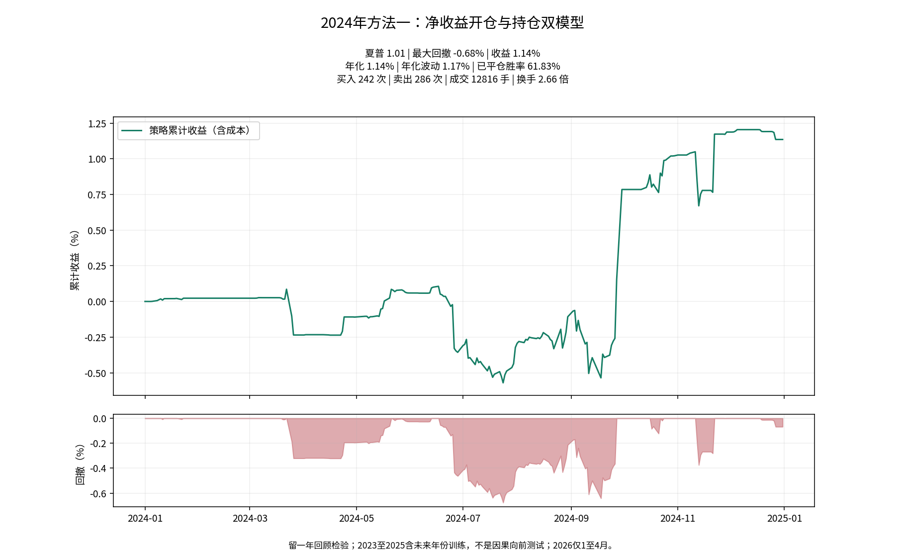

# 2024年方法一：净收益开仓与持仓双模型

规则：`shallow_regularized_continuation0_atr20_40_q0.5`（内部验证平均正夏普、交易数及正收益片段数达标）。

| 指标                             | 结果       |
|:---------------------------------|:-----------|
| 总收益率                         | 1.14%      |
| 年化收益率                       | 1.14%      |
| 年化波动率                       | 1.17%      |
| 夏普比率                         | 1.0149     |
| 下行风险调整收益比               | 1.8431     |
| 最大回撤                         | -0.68%     |
| 年化收益与最大回撤比             | 1.6811     |
| 买入成交次数                     | 242.0000   |
| 卖出成交次数（含部分卖出）       | 286.0000   |
| 完全平仓批次数                   | 241.0000   |
| 双边成交手数                     | 12816.0000 |
| 完全平仓批次胜率                 | 61.83%     |
| 平均持仓自然日                   | 5.6238     |
| 双边换手倍数                     | 2.6616     |
| 手续费合计（元，不含价格内滑点） | 2829.0675  |
| 平均多头仓位比例                 | 1.58%      |
| 交易日数                         | 242.0000   |
| 期末未平仓批次                   | 1.0000     |

## 限制

- 留一年回顾检验；2023至2025含未来年份训练，不是因果向前测试；2026仅1至4月。
- 每轮外层测试年没有进入该轮拟合/校准/验证，但前三轮的训练数据在测试年之后；年份之间角色轮换不是四个完全独立实验。
- 每个训练年按交易日分为60%拟合、20%校准、20%验证，分段起点隔离7自然日；标签和虚拟批次入场不得跨越拟合边界。模型冻结后不再重拟合，避免分数阈值漂移。
- 持仓模型预测继续一天相对立即卖出的收益，不是最优停止证明；虚拟批次不模拟入场资金和止损存活，存在训练与真实持仓分布差异。
- 主模型预测次日收益，保护规则允许最多10或20交易日；滚动判断不保证以预测期限或止损价成交。ATR是240根原始分钟的平均真实波幅，候选10/20/40倍是风险保护，不是日ATR。
- 任一年收益无波动则四年平均夏普未定义且目标不达标；不能删除空仓/亏损年后声称平均大于3。全部年份都有有效夏普时按四年等权算术均值评价。
- 历史数据已被此前研究查看；本轮是预先固定流程的历史稳健性检查，不是全新未见样本。
- 原始行情无完整历史ST状态、退市总表、复权因子和公司行动。使用2026年名称快照排除ST/退，仍有前视筛选及幸存者偏差；原始价格的分红拆股也未完整记账。
- 交易只在信号之后的下一分钟收盘模拟成交。使用双边万八佣金、免5、日期对应印花税、双边十万分之一过户费和双边万五滑点。
- 每次成交额最多占下一分钟成交额5%，零量/缺失不成交；主板前收盘±9.5%是保守阻成交代理，不等于完整涨跌停、集合竞价及排队模型。停牌持仓用最后可见价格估值，无法反映退市损失。
- 止损在24分钟采样点和日终检查，不是逐分钟监控；T+1或无法卖出时保存待平仓状态，不保证以止损价成交。入场后的首个监控区间保守只用当前收盘更新最高价，避免引入买入前的分钟内高点。
- 各年从相同现金独立启动，年末持仓按市值保留，不虚构强制成交。跨年拼接只是独立年度收益的统计连接，不是连续持仓实盘仿真。
- 方法二沿用方法一的XGBoost核心，仅增加CTA叠加，不能假定两者为独立收益来源。
