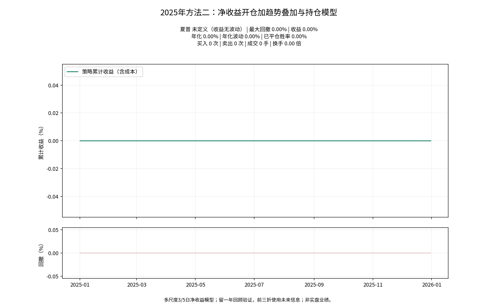

# 2025年方法二：净收益开仓加趋势叠加与持仓模型

规则：`cash_validation_failed`（内部验证不达标，按事前协议保持现金，非漏跑测试）。

全程现金、没有交易，夏普在统计上未定义；CSV中的0仅是无波动占位值，不是有效策略表现。

| 指标                             | 结果                       |
|:---------------------------------|:---------------------------|
| 总收益率                         | 0.00%                      |
| 年化收益率                       | 0.00%                      |
| 年化波动率                       | 0.00%                      |
| 夏普比率                         | 未定义（收益无波动）       |
| 下行风险调整收益比               | 0.0000                     |
| 最大回撤                         | 0.00%                      |
| 年化收益与最大回撤比             | 0.0000                     |
| 买入成交次数                     | 0.0000                     |
| 卖出成交次数（含部分卖出）       | 0.0000                     |
| 完全平仓批次数                   | 0.0000                     |
| 双边成交手数                     | 0.0000                     |
| 完全平仓批次胜率                 | 未定义（没有完全平仓批次） |
| 平均持仓自然日                   | 0.0000                     |
| 双边换手倍数                     | 0.0000                     |
| 手续费合计（元，不含价格内滑点） | 0.0000                     |
| 平均多头仓位比例                 | 0.00%                      |
| 交易日数                         | 243.0000                   |
| 期末未平仓批次                   | 0.0000                     |

## 限制

- 当前信号另要求非一字线且成交额至少200000元；这是当前可见资格，不保证下一分钟可成交。
- 多日开仓目标为3或5交易日净收益，持仓模型仍预测继续一天增益；比较最早满足T+1的时间退出对照与动态退出，不是固定价位止盈。
- 增加的多日因子由过去共同时钟收盘计算；60交易日窗口不是60分钟。当期环境仅统计当时合资格周池，不使用未来入池股票。
- 留出年后60个交易日不进入拟合、校准或验证，避免长窗口特征借用留出年价格；因此2025留出折的2026核心拟合可能为空，但2026仍参与其他折拟合及本折后段选参。
- future_trained记录核心模型是否拟合未来年份；future_selection记录是否使用未来年份校准/验证。2025折即使没有未来核心拟合，仍因未来选参属于回顾研究。
- 60日隔离覆盖新增有界窗口；旧分钟因子含EMA/RSI等递推状态，长期缺行情股票的跨段记忆未逐一重置，不能声称全部特征与留出年行情严格独立。
- 每个训练年按交易日分为60%拟合、20%校准、20%验证，分段起点隔离7自然日；标签和虚拟批次入场不得跨越拟合边界。模型冻结后不再重拟合，避免分数阈值漂移。
- 持仓模型预测继续一天相对立即卖出的收益，不是最优停止证明；虚拟批次不模拟入场资金和止损存活，存在训练与真实持仓分布差异。
- 任一年收益无波动则四年平均夏普未定义且目标不达标；不能删除空仓/亏损年后声称平均大于3。全部年份都有有效夏普时按四年等权算术均值评价。
- 历史数据已被此前研究查看；本轮是预先固定流程的历史稳健性检查，不是全新未见样本。
- 原始行情无完整历史ST状态、退市总表、复权因子和公司行动。使用2026年名称快照排除ST/退，仍有前视筛选及幸存者偏差；原始价格的分红拆股也未完整记账。
- 交易只在信号之后的下一分钟收盘模拟成交。使用双边万八佣金、免5、日期对应印花税、双边十万分之一过户费和双边万五滑点。
- 每次成交额最多占下一分钟成交额5%，零量/缺失不成交；主板前收盘±9.5%是保守阻成交代理，不等于完整涨跌停、集合竞价及排队模型。停牌持仓用最后可见价格估值，无法反映退市损失。
- 止损在24分钟采样点和日终检查，不是逐分钟监控；T+1或无法卖出时保存待平仓状态，不保证以止损价成交。入场后的首个监控区间保守只用当前收盘更新最高价，避免引入买入前的分钟内高点。
- 各年从相同现金独立启动，年末持仓按市值保留，不虚构强制成交。跨年拼接只是独立年度收益的统计连接，不是连续持仓实盘仿真。
- 方法二沿用方法一的XGBoost核心，仅增加CTA叠加，不能假定两者为独立收益来源。