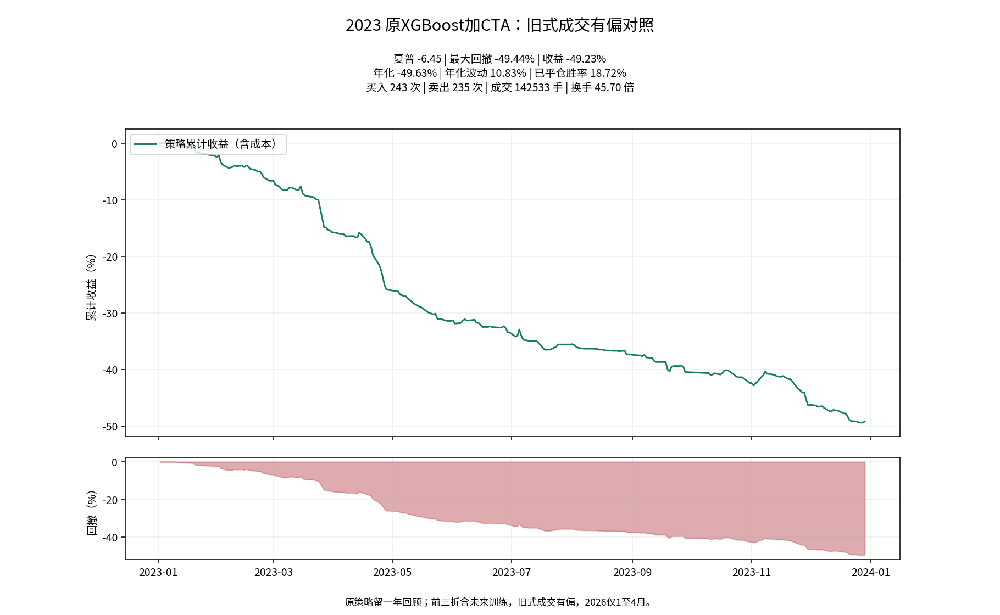

# 2023 原XGBoost加CTA：旧式成交有偏对照

规则：`atr_initial2_trail4_atr240`（原规则固定；本折内部90%门槛校准；验证只诊断，不按测试选择）。

| 指标                             | 结果        |
|:---------------------------------|:------------|
| 总收益率                         | -49.23%     |
| 年化收益率                       | -49.63%     |
| 年化波动率                       | 10.83%      |
| 夏普比率                         | -6.4538     |
| 下行风险调整收益比               | -6.4146     |
| 最大回撤                         | -49.44%     |
| 年化收益与最大回撤比             | -1.0039     |
| 买入成交次数                     | 243.0000    |
| 卖出成交次数（含部分卖出）       | 235.0000    |
| 完全平仓批次数                   | 235.0000    |
| 双边成交手数                     | 142533.0000 |
| 完全平仓批次胜率                 | 18.72%      |
| 平均持仓自然日                   | 2.2904      |
| 双边换手倍数                     | 45.6971     |
| 手续费合计（元，不含价格内滑点） | 34382.0395  |
| 平均多头仓位比例                 | 44.07%      |
| 交易日数                         | 242.0000    |
| 期末未平仓批次                   | 8.0000      |

## 限制

- 本轮是原XGBoost/CTA策略的年度回顾，不是最近的LightGBM/净收益模型族。前三折含未来年份训练；2026仅1至4月，不能当当年可部署或全新未见样本。
- 固定156列来自历史因子筛选，历史数据已经反复查看；重新按折拟合不消除历史特征选择及研究选择偏差。
- 保留原24个观测分钟收益截面排名目标、XGBoost参数、CTA公式和ATR240的2/4倍退出；非原二进制模型逐年自测。门槛按每折内部校准top1分数90%分位，不复制旧模型绝对分值。
- 每个非留出年按60%/20%/20%交易日切核心/校准/验证，片段起点隔离7自然日，模型只拟合核心，不在校准后重训。验证不选择新参数，不按其成绩删除年度或停用原策略。
- 为隔离年份，递推/累计因子每年初始化，有限因子仅在该年观察241条后复用；训练和校准不使用跨年周池。全部截面贡献者来源同年，核心收益排名在剔除跨窗口标签后重新计算。
- 沿用已有周度高波动300股缓存和24交易分钟公共时钟，修正原逐股票全历史行号采样及按未来缺标签删推断股票；因此不是原2026年7月报告数值的逐字复现。当前名称ST/退过滤、幸存者及公司行动/复权缺失偏差仍在。
- 旧式口径直接调用原lot函数，卖出读取成交分钟价格/高点/ATR并同刻成交，属于有偏对照；其预算取成交时卖出后权益，零滑点/无限容量/固定卖出万五税率，不能作为实盘夏普验收。
- 约束版只读已完成信号分钟，精确下一分钟尝试成交；入场ATR取信号值，保留2/4原公式（ATR变大时线可放松），不追加近期研究的20/40倍、3/5日期限或离池退出。15:00只估值，不新增旧策略没有的收盘退出检查。
- 两口径均前5、每批最多总资产10%、隔日可独立加仓、T+1、100股、万八免5。约束版追加双边万五滑点、分钟5%共享成交额和前收±9.5%阻成交代理，税率按日期；不等于完整涨跌停排队模型。
- 约束版退出遇T+1/缺价/容量不足会保留待退出或部分卖出；旧式函数不持久化受阻止损意图。两个口径的差异不只滑点，不应全部归因手续费。
- 标准曲线由全部公共日终估值计算日频夏普（含现金日、ddof=1、252日、无风险0），年化收益按实际自然日365.25。旧式原bar指标单独留档，不能与标准日频夏普混用。
- 各年初100万元、年末按市值保留持仓，不虚构强平；两个方法共享同折XGBoost模型，不是两个独立风险来源。不根据外层成绩回选方法/口径/年度。
