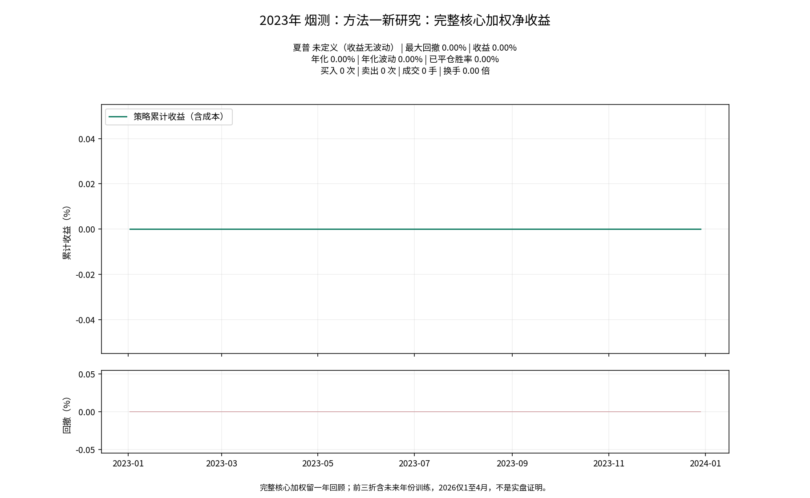

# 2023年 烟测：方法一新研究：完整核心加权净收益

规则：`cash_validation_failed`（内部未达事前启用标准，现金保护）。

全程现金、没有交易，夏普在统计上未定义；CSV中的0仅是无波动占位值，不是有效策略表现。

| 指标                             | 结果                       |
|:---------------------------------|:---------------------------|
| 总收益率                         | 0.00%                      |
| 年化收益率                       | 0.00%                      |
| 年化波动率                       | 0.00%                      |
| 夏普比率                         | 未定义（收益无波动）       |
| 下行风险调整收益比               | 0.0000                     |
| 最大回撤                         | 0.00%                      |
| 年化收益与最大回撤比             | 0.0000                     |
| 买入成交次数                     | 0.0000                     |
| 卖出成交次数（含部分卖出）       | 0.0000                     |
| 完全平仓批次数                   | 0.0000                     |
| 双边成交手数                     | 0.0000                     |
| 完全平仓批次胜率                 | 未定义（没有完全平仓批次） |
| 平均持仓自然日                   | 0.0000                     |
| 双边换手倍数                     | 0.0000                     |
| 手续费合计（元，不含价格内滑点） | 0.0000                     |
| 平均多头仓位比例                 | 0.00%                      |
| 交易日数                         | 242.0000                   |
| 期末未平仓批次                   | 0.0000                     |

## 限制

- 历史数据已被此前研究查看；本轮是预先固定流程的历史稳健性检查，不是全新未见样本。
- 原始行情无完整历史ST状态、退市总表、复权因子和公司行动。使用2026年名称快照排除ST/退，仍有前视筛选及幸存者偏差；原始价格的分红拆股也未完整记账。
- 交易只在信号之后的下一分钟收盘模拟成交。使用双边万八佣金、免5、日期对应印花税、双边十万分之一过户费和双边万五滑点。
- 每次成交额最多占下一分钟成交额5%，零量/缺失不成交；主板前收盘±9.5%是保守阻成交代理，不等于完整涨跌停、集合竞价及排队模型。停牌持仓用最后可见价格估值，无法反映退市损失。
- 止损在24分钟采样点和日终检查，不是逐分钟监控；T+1或无法卖出时保存待平仓状态，不保证以止损价成交。入场后的首个监控区间保守只用当前收盘更新最高价，避免引入买入前的分钟内高点。
- 各年从相同现金独立启动，年末持仓按市值保留，不虚构强制成交。跨年拼接只是独立年度收益的统计连接，不是连续持仓实盘仿真。
- 执行路径标签留一年回顾；前三折包含未来年份信息，2026仅1至4月，不是实盘证明。
- 原固定期限价格标签与实际ATR/部分卖出不同。本轮按独立初始账户模拟一次10%预算入场，并在ATR或H交易日到期后尝试退出，观察至H+5交易日同刻。没有买入的意图收益为0，尚未退出者按窗口末市值记账，不伪造强平。
- 独立标签不共享不同意图之间的资金、卖出容量和后续加仓，不能当真实组合收益。实际组合仍由共同账户引擎模拟，可能比独立意图更受资金/容量约束。
- 2026是否实际参与核心拟合以split_audit.csv为准；2025留出折2026核心可能为空但后段用于内部选参。年份轮换不是四个独立实验，历史也已被反复研究。
- 修复了成交量NaN、无效前收或非正/无限执行价格和成交额可绕过比较的保护。旧实验保留源码快照，不能修改旧指纹绕过冻结审计；原始特征缓存未重建。
- 至少一种方法四折内部启用才允许正式外层。每方法完整四年平均夏普严格大于3才达标，现金无波动年不许删除，内部夏普不能当年度外层成绩。
- 本轮使用同股每天预定一个钟的全部完整核心入口，训练内部潜在窗口可以重叠；按同股同年潜在区间的平均1/并发数降权，再令每日总权重相同。权重不能消除时间/跨股票依赖，也不等于独立样本量。
- 跨核心、校准、验证、留出年的完整潜在标签边界与实际量价来源隔离不放宽；即使提前平仓仍按H+5窗口过滤，不按盈利与否放宽。
- 方法一用固定29个当时输入预测账户净收益；方法二用5个当时环境量预测核心同刻共同净收益、24个个股量预测相对残差，推断相加。不从验证/测试标签计算环境均值、标准化或分数校准，正相对收益不意味着绝对盈利。
- 共同目标是核心预定入口样本的加权同刻平均，不是整个股票池未来收益或可交易基准；这些入口不共享现金/容量。分解模型不是市场中性策略，不存在空头或可获得的对冲收益。
- 本轮不强制推断残差在当前截面归零；每行的两个冻结分量直接相加，支持等价分批推断。旧path_training_phase仅用于抽90个路径参考案例，不再用于实际核心拟合。
