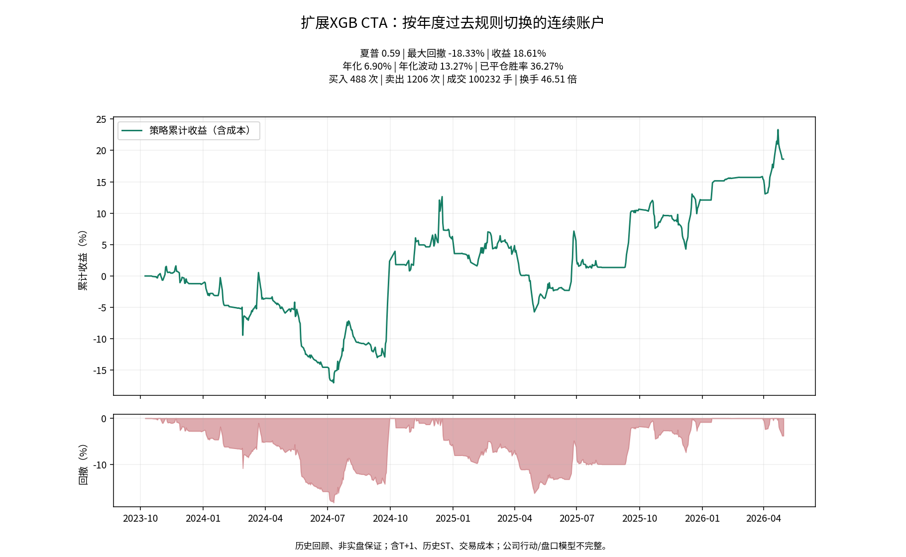

# 扩展XGB CTA：按年度过去规则切换的连续账户

历史回顾、非实盘保证；

规则：`exit0_regularized_probability_trend_120_0.5`。

| 指标                   | 结果    |
|:-----------------------|:--------|
| 总收益率               | 18.61%  |
| 年化收益率             | 6.90%   |
| 夏普                   | 0.5871  |
| 最大回撤               | -18.33% |
| 年化波动               | 13.27%  |
| 买入次数               | 488     |
| 卖出次数（含部分成交） | 1206    |
| 完全平仓批次           | 488     |
| 科创板买入次数         | 4       |
| 创业板买入次数         | 0       |
| 完全平仓胜率           | 36.27%  |
| 平均持仓自然日         | 10.36   |
| 双边换手倍数           | 46.51   |
| 期末未平仓批次         | 0       |

## 成交审计

独立现金、费用、T+1、板块数量、日涨跌停价、容量和每笔10%预算检查通过。通过不等于数据完整或可实盘。

## 已知限制

- 本轮严格按时间向前拟合，但历史行情已被其他研究查看，不能称为全新独立测试。
- 历史ST来自BaoStock，缺失禁止新买；未使用当前名称快照。第三方日线不等于完整交易所状态档案，退市整理/特殊复牌/临时停牌及公司行动仍可能不完整。
- 历史tradestatus必须为1才撮合买卖；非正常/未知状态即使分钟文件出现正成交量也不成交。数据源存在此类矛盾，不能仅凭日收盘一致认为状态完整可信。
- 本地分钟收盘与第三方未复权日收盘作对照。现金分红、送转股和红利税尚未完整入账；不能因此宣称已达到实盘级总回报核算。日线历史参考价并不保证涵盖所有特殊交易日。
- 主板10%、创业板/科创板20%正常日价格限制按参考前收盘四舍五入到分；至少60个历史交易日后入池，排除新上市前五日。特殊复牌无涨跌幅限制、盘口排队及完整价格笼子未精确模拟。
- 成交用信号后下一分钟收盘加滑点并按分取整，信号参考价上下2%保护，成交额最多占本分钟5%；这不是逐笔盘口重放。部分卖出会继续等待，不能按理想止损价保证成交。
- ATR取上一已完成日的14日简单平均真实波幅；每分钟先检查上根已知保护线是否被本分钟低价触及，再更新高点，更新后的线只与当前收盘比较，避免假设分钟高低点先后。
- 每批次T+1、ATR/趋势/到期退出独立；跨年连续账户保留旧批次原退出参数。独立年度账户重置初始现金，不能与连续账户收益混称。
- 训练标签是单笔固定10%初始资金预算下的净收益。共享账户的资金竞争、动态总资产和单股上限另外模拟；标签不是完整组合收益。
- 科创板至少200股、逐股递增。成交手数是成交股数/100的统计单位，出现小数不是违规；买入不足200股才是违规。
- 无成交或日收益无波动时夏普未定义。程序内部0为数值占位，报告显示未定义，不能据此计算成功比例。
