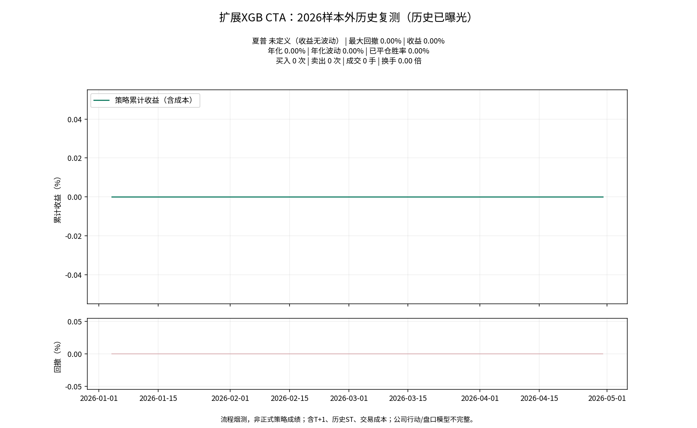

# 扩展特征XGBoost CTA研究总报告

2026净日收益夏普>2：未达到。不是未来盈利承诺。

特征候选724列，内部真实账户18组；全量模型仅拟合2023—2025。2026截至4月30日，历史已曝光。

## 年度结果

|   年度 | 评价性质                     |   收益率 |   年化收益 |   夏普 |   最大回撤 |   买入次数 |   完整平仓批次 |
|-------:|:-----------------------------|---------:|-----------:|-------:|-----------:|-----------:|---------------:|
|   2023 | 向前历史验证                 |        0 |          0 |      0 |          0 |          0 |              0 |
|   2024 | 向前历史验证                 |        0 |          0 |      0 |          0 |          0 |              0 |
|   2025 | 向前历史验证                 |        0 |          0 |      0 |          0 |          0 |              0 |
|   2023 | 样本内回放，不能证明泛化     |        0 |          0 |      0 |          0 |          0 |              0 |
|   2024 | 样本内回放，不能证明泛化     |        0 |          0 |      0 |          0 |          0 |              0 |
|   2025 | 样本内回放，不能证明泛化     |        0 |          0 |      0 |          0 |          0 |              0 |
|   2026 | 样本外历史复测（历史已曝光） |        0 |          0 |      0 |          0 |          0 |              0 |

收益/回撤为小数，例如0.10表示10%。2023向前验证仅第四季度。向前行的权重/规则只来自过去，但历史设计已被反复研究；样本内行不能用于判断泛化。

## 策略与研究边界

上周波动前300周池、模型门槛及CTA趋势/突破/回调条件共同触发；每次最多前5，每批预算为总资产10%，单股20%、总仓80%。信号后下一分钟执行，只做多，T+1。每批独立初始ATR止损、只上移的吊顶保护线、可选跌破过去EMA20退出和最大交易分钟期限，不因离开目标池平仓。

本轮实现净收益、盈利概率、25%分位数三类目标比较；未实现持仓状态学习退出模型，也未做概率校准。全量重训后绝对分数门槛可能漂移；不能用2026调整。全部预注册候选及失败结果保留，结果揭示后停止本轮，不以反复看测试集制造达标。

本轮仅755只有本地历史状态的股票中曾入池的722只（主板为主，创业板/科创板各3只）；不是全A研究。

# 扩展XGB CTA：2026样本外历史复测（历史已曝光）

流程烟测，非正式策略成绩；

规则：`exit0_shallow_downside_trend_120_0.0`。

| 指标                   | 结果             |
|:-----------------------|:-----------------|
| 总收益率               | 0.00%            |
| 年化收益率             | 0.00%            |
| 夏普                   | 未定义（无波动） |
| 最大回撤               | 0.00%            |
| 年化波动               | 0.00%            |
| 买入次数               | 0                |
| 卖出次数（含部分成交） | 0                |
| 完全平仓批次           | 0                |
| 科创板买入次数         | 0                |
| 创业板买入次数         | 0                |
| 完全平仓胜率           | 未定义           |
| 平均持仓自然日         | 0.00             |
| 双边换手倍数           | 0.00             |
| 期末未平仓批次         | 0                |

## 成交审计

独立现金、费用、T+1、板块数量、日涨跌停价、容量和每笔10%预算检查通过。通过不等于数据完整或可实盘。

## 已知限制

- 本轮严格按时间向前拟合，但历史行情已被其他研究查看，不能称为全新独立测试。
- 历史ST来自BaoStock，缺失禁止新买；未使用当前名称快照。第三方日线不等于完整交易所状态档案，退市整理/特殊复牌/临时停牌及公司行动仍可能不完整。
- 历史tradestatus必须为1才撮合买卖；非正常/未知状态即使分钟文件出现正成交量也不成交。数据源存在此类矛盾，不能仅凭日收盘一致认为状态完整可信。
- 本地分钟收盘与第三方未复权日收盘作对照。现金分红、送转股和红利税尚未完整入账；不能因此宣称已达到实盘级总回报核算。日线历史参考价并不保证涵盖所有特殊交易日。
- 主板10%、创业板/科创板20%正常日价格限制按参考前收盘四舍五入到分；至少60个历史交易日后入池，排除新上市前五日。特殊复牌无涨跌幅限制、盘口排队及完整价格笼子未精确模拟。
- 成交用信号后下一分钟收盘加滑点并按分取整，信号参考价上下2%保护，成交额最多占本分钟5%；这不是逐笔盘口重放。部分卖出会继续等待，不能按理想止损价保证成交。
- ATR取上一已完成日的14日简单平均真实波幅；每分钟先检查上根已知保护线是否被本分钟低价触及，再更新高点，更新后的线只与当前收盘比较，避免假设分钟高低点先后。
- 每批次T+1、ATR/趋势/到期退出独立；跨年连续账户保留旧批次原退出参数。独立年度账户重置初始现金，不能与连续账户收益混称。
- 训练标签是单笔固定10%初始资金预算下的净收益。共享账户的资金竞争、动态总资产和单股上限另外模拟；标签不是完整组合收益。
- 科创板至少200股、逐股递增。成交手数是成交股数/100的统计单位，出现小数不是违规；买入不足200股才是违规。
- 无成交或日收益无波动时夏普未定义。程序内部0为数值占位，报告显示未定义，不能据此计算成功比例。
