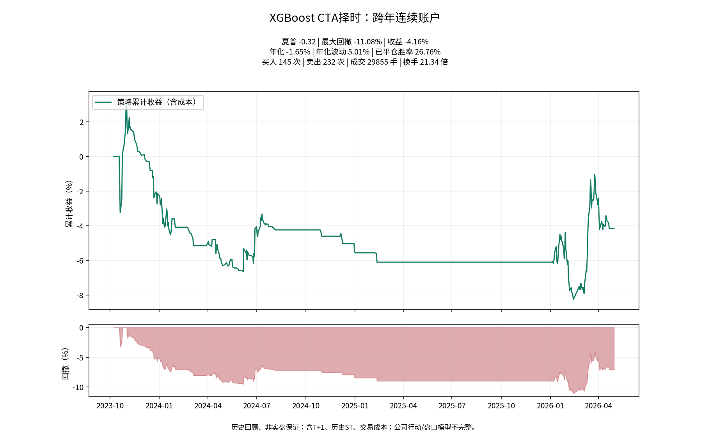

# 三板块XGBoost CTA向前验证

> 状态资格检查未完成的旧轮次，不是最终修正版。请先阅读[数据资格问题说明](数据资格问题说明.md)。原始自动报告另存为final_report_before_status_notice.md；原模型、交易与指标均未改写。

**本轮未达到夏普大于3目标。**

**覆盖范围：755/5332只本地合格股票。仅为已缓存历史状态的本地覆盖子集，下载顺序偏向沪市主板；不是全市场或均衡三板块样本。周度Top300仅在该子集中计算，未要求股票在整个未来期间持续存在或无缺失。**

| 板块   |   原始合格股票 |   本轮股票 |
|:-------|---------------:|-----------:|
| 主板   |           3302 |        749 |
| 创业板 |           1420 |          3 |
| 科创板 |            610 |          3 |

扩展特征285列，1,348,013个信号样本，周池累计722只股票。复用25只股票原因子，其余只补缺少的板块/时间覆盖。历史日收盘不一致记录0条。

## 各年度独立账户

|   年度 | 实际测试范围           | 净收益   |   夏普 | 最大回撤   |   买入次数 |   完整平仓批次 |
|-------:|:-----------------------|:---------|-------:|:-----------|-----------:|---------------:|
|   2023 | 2023-10-09至2023-12-29 | -2.13%   | -0.897 | -5.73%     |         49 |             39 |
|   2024 | 2024-01-02至2024-12-31 | -1.41%   | -0.385 | -3.70%     |         45 |             44 |
|   2025 | 2025-01-02至2025-12-31 | -0.57%   | -1.103 | -0.57%     |          1 |              1 |
|   2026 | 2026-01-05至2026-04-30 | 1.88%    |  0.733 | -4.05%     |         50 |             47 |

各年度夏普简单均值：-0.413（有无波动年则未定义，不删除该年）。2023不是全年、2026截至4月。

## 跨年连续账户

净收益-4.16%，夏普-0.319，最大回撤-11.08%，买入145次、完整平仓142批。双倍滑点夏普-0.360、净收益-4.65%。

日收益块自助法夏普95%区间：[-1.7695477291595827, 0.9324223062860972]；不能消除选择偏差。

## 牛熊震荡

| 市场阶段   |   交易日数 |   平均日收益 |   条件日收益夏普 |   该状态日收益连乘 |   平均持仓 |
|:-----------|-----------:|-------------:|-----------------:|-------------------:|-----------:|
| 熊市趋势   |        129 | -0.000294597 |        -1.02555  |         -0.0385753 |  0.145763  |
| 牛市趋势   |        202 | -0.000115813 |        -1.69301  |         -0.02324   |  0.0166947 |
| 震荡       |        291 |  7.5599e-05  |         0.357332 |          0.0205757 |  0.0782637 |

阶段取沪深300上一已完成日60日涨跌幅，超过±5%分别为牛/熊趋势，其余震荡。这是条件日收益诊断，非连续可交易的独立子策略；不会根据该表再选模型。

## 全流程

历史状态审计 → 上周高波动周池 → 复用/扩展特征PKL → T+1退出路径标签 → 逐折过去特征筛选和XGBoost拟合 → 内部验证选CTA/频率/门槛 → 全部冻结 → 逐年独立账户 → 连续账户/固定成本压力测试 → 独立账本审计 → 中文报告。

## 限制与实盘边界

- 本轮严格按时间向前拟合，但历史行情已被其他研究查看，不能称为全新独立测试。
- 历史ST来自BaoStock，缺失禁止新买；未使用当前名称快照。第三方日线不等于完整交易所状态档案，退市整理/特殊复牌/临时停牌及公司行动仍可能不完整。
- 本地分钟收盘与第三方未复权日收盘作对照。现金分红、送转股和红利税尚未完整入账；不能因此宣称已达到实盘级总回报核算。日线历史参考价并不保证涵盖所有特殊交易日。
- 主板10%、创业板/科创板20%正常日价格限制按参考前收盘四舍五入到分；至少60个历史交易日后入池，排除新上市前五日。特殊复牌无涨跌幅限制、盘口排队及完整价格笼子未精确模拟。
- 成交用信号后下一分钟收盘加滑点并按分取整，信号参考价上下2%保护，成交额最多占本分钟5%；这不是逐笔盘口重放。部分卖出会继续等待，不能按理想止损价保证成交。
- ATR取上一已完成日的14日简单平均真实波幅；每分钟先检查上根已知保护线是否被本分钟低价触及，再更新高点，更新后的线只与当前收盘比较，避免假设分钟高低点先后。
- 每批次T+1、ATR/趋势/到期退出独立；跨年连续账户保留旧批次原退出参数。独立年度账户重置初始现金，不能与连续账户收益混称。
- 训练标签是单笔固定10%初始资金预算下的净收益。共享账户的资金竞争、动态总资产和单股上限另外模拟；标签不是完整组合收益。
- 科创板至少200股、逐股递增。成交手数是成交股数/100的统计单位，出现小数不是违规；买入不足200股才是违规。
- 无成交或日收益无波动时夏普未定义。程序内部0为数值占位，报告显示未定义，不能据此计算成功比例。
